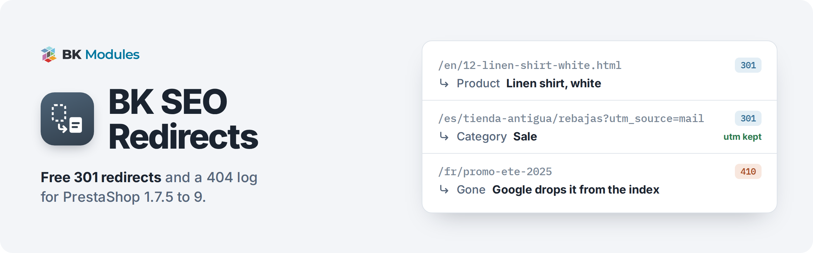
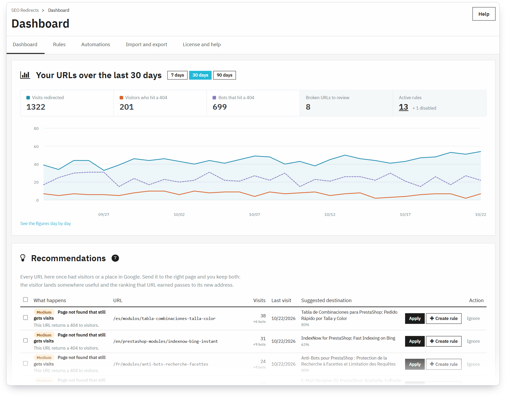
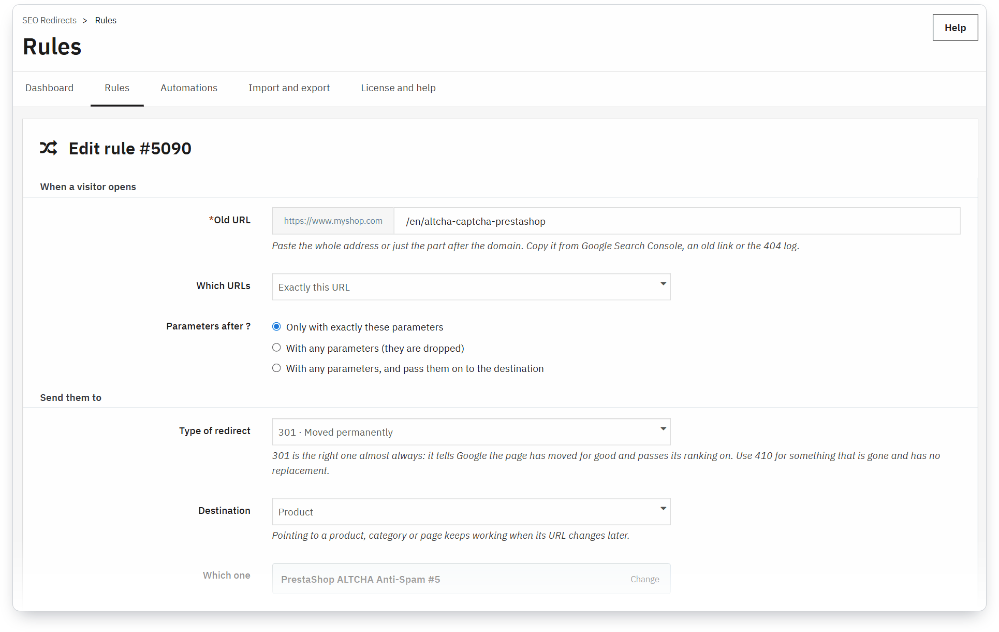
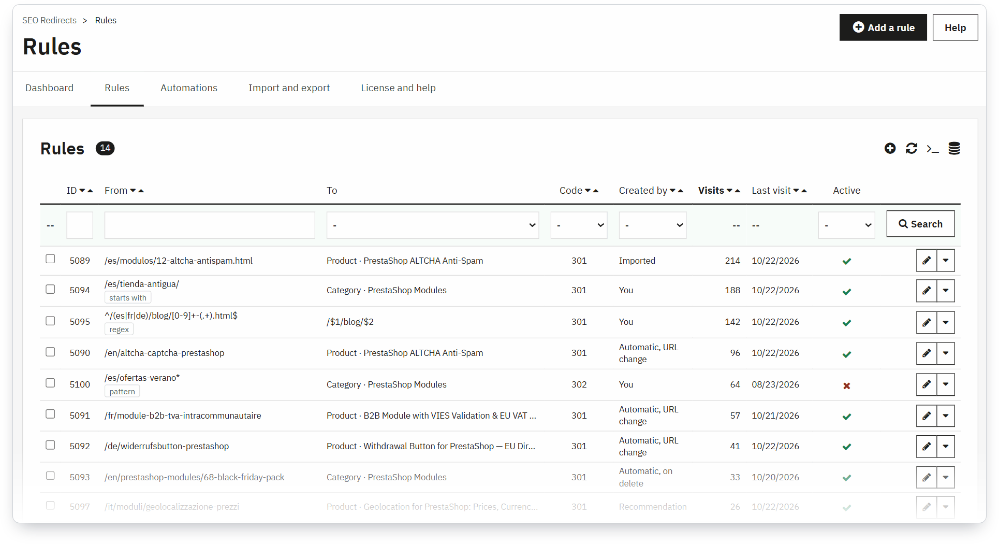

<a href="https://bkmodules.com/prestashop-modules/redirects-301-prestashop?utm_source=github&utm_medium=readme&utm_campaign=bkredirects">
  <picture>
    <source media="(prefers-color-scheme: dark)" srcset=".github/assets/banner-dark.png">
    
  </picture>
</a>

  
  
  
  

  <a href="https://github.com/BK-Modules/bkredirects/releases/latest"><b>Download</b></a>
  &nbsp;·&nbsp;
  <a href="https://bkmodules.com/prestashop-modules/redirects-301-prestashop?utm_source=github&utm_medium=readme&utm_campaign=bkredirects">Product page</a>
  &nbsp;·&nbsp;
  <a href="https://bkmodules.com/prestashop-modules/redirects-301-prestashop?utm_source=github&utm_medium=readme&utm_campaign=bkredirects&utm_content=pro">Get PRO</a>

You deleted a product, renamed a category or moved from PrestaShop 1.6, and Google still sends people to the old address. PrestaShop answers with a 404: the visitor leaves and the page loses its ranking.

**BK SEO Redirects** sends every old URL to the page that replaces it with a 301, so visitors land somewhere useful and Google passes the ranking on. It logs every 404 your shop serves, tells people from bots, and lists the broken URLs that still get visits so you fix those first. Free, with no limit on rules.

## Install in three steps

1. **Download** `bkredirects-x.y.z.zip` from the [latest release](https://github.com/BK-Modules/bkredirects/releases/latest).
2. In your back office, go to **Modules › Module Manager › Upload a module** and drop the zip.
3. Open **Shop Parameters › SEO Redirects**. Add your first rule, or start from the 404s on the dashboard.

That's all: no file to edit, no cache to clear.

## What you get

The dashboard: visits redirected, 404s from people and from bots, and the broken URLs worth fixing first. The suggested destination and the bulk “Apply” come with PRO.

- **Rules that survive URL changes.** Point a rule at a product, category, CMS page, brand or supplier rather than a typed address. The module works out the URL on every visit, in the visitor's language, so the rule keeps working however often that page is renamed.
- **301, 302, 307 and 410.** 410 tells Google a page is gone for good and has no replacement.
- **Campaign tracking kept.** `?utm_source=…` and any other parameters reach the destination.
- **404 log with bots apart**, a 30-day dashboard and a list of recommendations with a one-click *Create rule*.
- **Guard rails.** Paste a full URL or a path and it is stored in the right form; duplicates are flagged; a rule whose destination is disabled or deleted stops redirecting and shows up on the dashboard instead of sending people to another 404; a rule that points at itself is never applied.
- **Multistore** (a rule per shop) and a back office in English, Spanish, French, Italian, German, Polish and Czech.

A rule: the old URL, the type of redirect and the page it now leads to.

Every rule with its visits and who created it. The “starts with”, pattern and regex rules are PRO.

## Free or PRO

The free edition fixes your 404s by hand, one rule at a time, with no limit and no expiry. PRO is for when you don't want to have to remember: it redirects on its own when you delete something or change a URL, brings in the redirects you already have and handles hundreds of addresses with one rule.

| | 🎁 Free | 👑 PRO |
| :--- | :---: | :---: |
| **Redirects** | | |
| Manual rules, no limit: 301, 302, 307 and 410 to a product, category, page or any URL | ✅ | ✅ |
| Your campaigns keep tracking: utm tags and other parameters reach the new page | ✅ | ✅ |
| Rules per shop and per language | Per shop | ✅ |
| One rule for hundreds of URLs: “starts with”, `*` wildcard and regular expressions | — | ✅ |
| What to do with parameters: ignore them, or redirect only the URL without them | — | ✅ |
| 303, 308 and 451 | — | ✅ |
| **404 errors** | | |
| 404 log and visits dashboard, people and bots counted apart | ✅ | ✅ |
| Recommendations with “Create rule” | ✅ | ✅ |
| Suggested destination, and several URLs fixed at once | — | ✅ |
| Chains and loops | Warning | Fixed |
| **What happens on its own** | | |
| When you delete a product, category, page, brand or supplier | — | ✅ |
| When you change a URL, the old one goes to the new one as you save | — | ✅ |
| CSV import and export, with a preview of every row | — | ✅ |
| Bring the rules you already have in other SEO modules | — | ✅ |
| **Updates** | Always | 3 or 12 months |

PRO is an add-on: you install it next to this module, and your rules, your 404 log and your settings stay where they were. In the free edition the PRO screens show with a padlock and one line on what they do, so you know what you'd gain before deciding. **[See PRO on bkmodules.com →](https://bkmodules.com/prestashop-modules/redirects-301-prestashop?utm_source=github&utm_medium=readme&utm_campaign=bkredirects&utm_content=pro)**

## What it does not do

- **No override.** It doesn't replace a single PrestaShop class, so it can't collide with another module's override.
- **No `.htaccess`.** Rules live in the database and are applied from the `actionDispatcherBefore` hook; your server config stays untouched and a typo in a rule can't take the shop down.
- **No extra work for pages without a rule.** Only front-office page requests are checked, with one indexed query; the back office and AJAX calls are never touched.
- **It doesn't override PrestaShop's own redirect** for disabled products (1.7.8+) and categories (9.0+). Where the core has one, it wins; the module covers what the core doesn't: deleted items, CMS pages, brands, suppliers and any arbitrary URL.

## Compatibility

| | |
| :--- | :--- |
| PrestaShop | 1.7.5 to 9.x |
| PHP | 7.1 or later |
| Multistore | Yes, rules per shop |
| Back office languages | en, es, fr, it, de, pl, cs |

## FAQ

<b>Will it slow my shop down?</b>

 
No. A page with no rule costs one indexed database lookup, and only on front-office page requests. AJAX calls and the back office are skipped.

<b>Should I use 301 or 302?</b>

 
301 almost always: it tells Google the page moved for good and passes its ranking on. 302 and 307 are for something temporary, and 410 for a page that is gone with no replacement.

<b>I used GitHub's “Download ZIP” and PrestaShop won't install it.</b>

 
That archive unpacks into <code>bkredirects-main/</code>, and PrestaShop needs the folder to be called <code>bkredirects</code>. Use the <code>bkredirects-x.y.z.zip</code> from <a href="https://github.com/BK-Modules/bkredirects/releases/latest">Releases</a>, which is ready to upload.

<b>If I move to PRO later, do I lose my rules?</b>

 
No. PRO installs next to the free module and works on the same rules and the same 404 log.

<b>What happens when I uninstall it?</b>

 
Redirects stop at once and the module removes its tables, rules and 404 log included. Disabling it keeps everything.

## Licence

[MIT](LICENSE). Use it, change it, ship it in client projects.

---

  Made by <a href="https://bkmodules.com/?utm_source=github&utm_medium=readme&utm_campaign=bkredirects"><b>BK Modules</b></a>, custom software with PrestaShop as a speciality. 
  Questions or a bug? <a href="https://github.com/BK-Modules/bkredirects/issues">Open an issue</a>.

